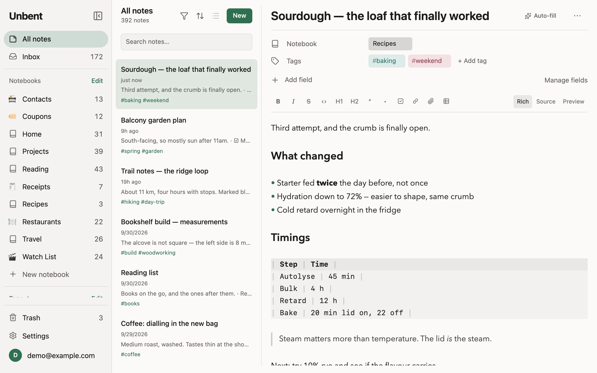
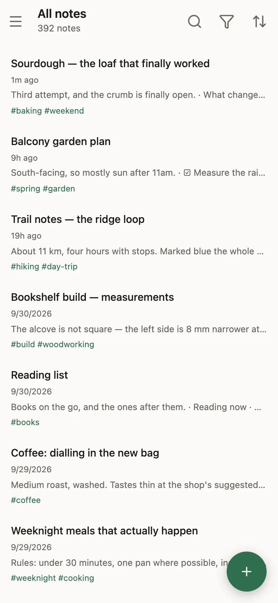

# Unbent

A personal note app that keeps your notes in Markdown and hands them back whenever you ask.

Notes are Markdown with YAML frontmatter. Attachments are ordinary files. Export produces a
plain folder tree (one directory per note, containing the note's markdown and a `files/`
subdirectory) that you can read, grep, and back up without this app existing, and import
back into any Unbent.

The Markdown is the note, not a serialization of one. A note you save is byte-identical to
what you typed: no reflowed lists, no `_italic_` quietly rewritten to `*italic*`, no escaped
underscores in a filename. That is the whole promise, and it is what makes the export
guarantee worth anything: a format the app rewrites behind your back is a format you do not
actually own.

Editing it should still feel like a word processor. See [Editing](docs/editor.md).

<p>
  <picture>
    <source srcset="apps/web/public/front/desktop-dark.webp" media="(prefers-color-scheme: dark)">
    
  </picture>
  <picture>
    <source srcset="apps/web/public/front/phone-dark.webp" media="(prefers-color-scheme: dark)">
    
  </picture>
</p>

## Why

Evernote's owner gave a lot of people a reason to leave. Leaving should be easy, and staying
should never depend on it being hard.

## What it does

- **Markdown is the stored truth.** Every note is a Markdown file with frontmatter, saved
  exactly as typed, and edited in place by a [word-processor-like editor](docs/editor.md)
  that never rewrites it.
- **Evernote import.** An ENEX export goes in whole, from the browser, and an interrupted
  import picks up where it stopped. Notion's export goes in the same way.
- **Folder export.** A zip of one directory per note, with the files beside it, that any
  Unbent reads back in. It is [your own backup](docs/backups.md), and the way out.
- **Search inside PDFs.** The text layer of every scanned PDF is indexed, so a scanned bill
  is [found by what it says](docs/search.md).
- **Notebook fields and Auto-fill.** A notebook can carry typed fields (dates, amounts,
  selects, ratings), and one press reads a note's files and [fills in whatever is
  empty](docs/search.md#filing-a-note-from-what-it-says).
- **An MCP server for assistants.** Claude, Cursor or anything that speaks the protocol can
  [search, read and write your notes](docs/assistants.md), with an approval you can revoke.
- **A library on the device.** The app opens with no connection and works: notes, notebooks
  and tags live in a [local copy](docs/sync-and-offline.md) kept current by a change feed,
  and edits made offline sync when it returns.
- **Android and iOS apps.** The site in a web view, with native sign-in, the share sheet
  and files: [Android](docs/android.md), [iOS](docs/ios.md).

A note's [history](docs/history-and-trash.md) keeps what an edit replaced, and the trash
keeps what was deleted.

## Use it or run your own

[unbent.app](https://unbent.app) is the hosted instance: a two-week trial, then one annual
plan, and an account that lapses stays readable and exportable. Or run your own on
Cloudflare: one Worker serves the site and the API, with a database and a bucket beside
it, and the free tier is enough.

[](https://deploy.workers.cloudflare.com/?url=https://github.com/MakeRocketGoNow/unbent)

[Running your own instance](docs/self-hosting.md) covers the button, GitHub Actions and
the laptop route, every setting an instance can take, and how sign-in methods are chosen.

## Layout

```
apps/web       Vite + React SPA
apps/api       Hono API on Workers, and the MCP server under src/mcp
apps/android   Kotlin app: the site in a WebView, with native sign-in, share sheet and files
apps/ios       Swift app: the site in a web view, with native sign-in and files
packages/shared  zod schemas, frontmatter codec, remark plugins
packages/enex    ENEX -> Markdown, runtime-agnostic
```

`apps/android` is a Gradle project, not a pnpm workspace package: `pnpm -r` skips it, and it
is built with its own wrapper. See [Android app](docs/android.md). `apps/ios` is an Xcode
project with two Swift packages beside it, skipped the same way. See [iOS app](docs/ios.md).

## Documentation

Everything else is in [docs/](docs/README.md): [setting up a checkout](docs/development.md),
[self-hosting](docs/self-hosting.md), [the editor](docs/editor.md),
[search and Auto-fill](docs/search.md), [sync and offline](docs/sync-and-offline.md),
[history and trash](docs/history-and-trash.md), [billing](docs/billing.md),
[the Android](docs/android.md) and [iOS](docs/ios.md) apps,
[architecture and durability](docs/architecture.md), [backups and export](docs/backups.md),
and the [known gaps](docs/known-gaps.md). [AGENTS.md](AGENTS.md) holds the standards the
code is held to.

## License

Unbent is source-available, not open source: the whole repository, mobile apps included,
is under the [Elastic License 2.0](LICENSE.md) (`Elastic-2.0`).

What it permits: use Unbent and modify it; run it for yourself, your family, or your own
company; redistribute the source; build the apps from it. What it forbids: offering it to
others as a hosted or managed service. That is the restriction that matters here, and it is
what keeps the hosted service viable while the code stays public. The license has two
more, which cost nothing in practice: its license-key clause, which Unbent has no license
keys for it to apply to, and its notices clause, which means keeping the copyright and
license text in any copy you pass on.

The [export guarantee](docs/backups.md) does not rest on the license. It rests on the
export itself: a plain folder of Markdown and files that needs no Unbent to read, which the
license does not touch.

Older commits carry the text of an earlier license from before the repository was public.
Nothing was ever distributed under it, and it grants no rights; [LICENSE.md](LICENSE.md)
says so at the top.

Contributions are accepted under the same terms; see [CONTRIBUTING.md](CONTRIBUTING.md).
