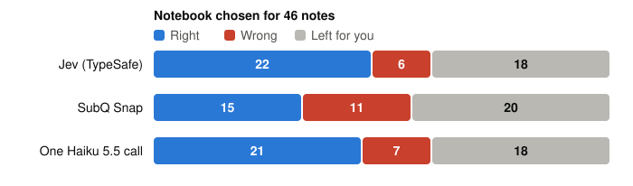

# Auto-fill's decision model, measured

SubQ Snap was pitched as the model that would replace TypeSafe's Jev: a decision model of
the same kind, with twelve times the context at a similar price. We put it in Jev's seat in
[Auto-fill](search.md#filing-a-note-from-what-it-says), the press that files a scan into a
notebook, tags it and fills its fields, and ran both on the same 46 notes from one real
archive, scored against how the owner had filed them.

**Snap was not the drop-in upgrade.** On this task it:

- **filed fewer notes right and more wrong**: 15 right and 11 wrong, against Jev's 22 and 6;
- **cost about 50% more per press** (0.15¢ against 0.10¢) despite a lower price per
  token, because its 16-question request limit splits the press into about ten requests
  that each resend the note's text;
- **was no faster**, since the press waits on the title call either way;
- **gained nothing from its 384k context**: on two documents of 56k and 108k characters,
  every choice was the same with the text cut at 40k.



| Per press, median of 46 | Jev | SubQ Snap | One Haiku 5.5 call |
|---|---|---|---|
| Notebook right / wrong / none | 22 / 6 / 18 | 15 / 11 / 20 | 21 / 7 / 18 |
| Field values right / wrong, where the notebook was right | 37 / 17 | 25 / 6 | 43 / 7 |
| Tags matching the owner's / extra | 9 / 21 | 11 / 25 | 16 / 36 |
| Seconds | 1.36 | 1.38 | 3.00 |
| Cents | 0.10 | 0.15 | 0.05 |
| Decision requests | 1.5 | 10.5 | 1 |

The third column is the alternative we were really weighing: one plain language-model call
doing all of it. It files about as well as either decision model at half Jev's price per
press (0.05¢ against 0.10¢), and its one cost is a second and a half on every press. The decision models' edge on this task is
speed, and only speed. We kept Jev.

**Read this as one data point.** One task, 46 notes, one person's filing as the answer key,
and a model five days past launch. A press designed around Snap's limits could come out
differently; we did not build one. The rest of this page is what was measured, what was
not, and how to run it on your own notes.

## Why Snap came out behind

- **Its request limit shapes the cost.** Snap refuses more than 16 questions per request (a
  422, as documented). The press's first round asks one yes-or-no per tag, up to 150, so a
  plain URL swap fails every press. The Snap arm splits each round into requests of 16 sent
  at once, each carrying the note's text again: 27k input tokens a press by Snap's own
  count, against about 20k for Jev, at a higher price per token. Any real swap would pay
  the same.
- **The notebook gap is not the confidence floor.** The press drops a notebook answered
  below 0.5 confidence, a number tuned on Jev. At every floor tried Snap stays behind: 14
  right and 7 wrong at 0.6, 19 and 14 at 0.4, against Jev's 22 and 6 at 0.5. Its top choice
  is right about as often (24 of 46 against 26), but it answered "none" once where Jev did
  seven times, it put five notes in the archive's catch-all notebook, and its confidence
  does not separate its right picks from its wrong ones the way Jev's does.
- **Per field it is about as accurate** (25 of 57 right where the notebook was right,
  against about 36 of 105). It gets fewer notebooks right, so it has fewer fields to fill.
- **Tags are slightly better**: two more matching, four more extra.
- **It is deterministic.** Three runs, identical answers. Jev's three runs moved one or two
  notes each, so differences of that size anywhere on this page are noise.

<details>
<summary>All three Jev runs beside Snap's</summary>

| | Jev, run 1 | Jev, run 2 | Jev, run 3 | Snap (3 runs, identical) |
|---|---|---|---|---|
| Notebook right / wrong / none | 22 / 6 / 18 | 21 / 6 / 19 | 21 / 6 / 19 | 15 / 11 / 20 |
| Field values right / wrong / missed, where the notebook was right | 37 / 17 / 56 of 110 | 36 / 18 / 51 of 105 | 36 / 17 / 49 of 102 | 25 / 6 / 26 of 57 |
| Tags matching the owner's / extra / missed | 9 / 21 / 21 | 9 / 20 / 21 | | 11 / 25 / 19 |
| Titles close to the owner's, of 13 | 3 | 4 | | 4 |
| Seconds per press, median | 1.36 | 1.36 | | 1.38 |
| Cents per press | 0.102 | 0.102 | | 0.152 |
| Decision requests per press | 1.5 | 1.5 | | 10.5 |

Jev's cost is estimated from request bytes at four to a token at $0.042 per million, since
TypeSafe reports no counts; Snap reports its usage and is billed at $0.05 per million. Both
bill output at nothing.

</details>

## The long-context question

Jev takes 32k tokens, so the press cuts a note's text at 40,000 characters
(`MAX_STATE_CHARS` in `lib/autofill.ts`). Snap takes 384k, and that was the reason to try
it. No note in the 46 came near the cap, so two long notes were pulled from outside the
sample: a contract of about 56,000 characters across two files, and a set of agreements of
about 108,000 across four.

- Every choice was the same at both caps. Both documents say what they are on their first
  pages, so the cut never reaches the text that decides, and that is likely true of most of
  a paperless archive.
- Raising the cap also sends the extra text to the title call, which is most of the cost
  rise.
- Two notes cannot prove a negative. But nothing here argues for raising the cap, and
  nothing argues that Jev's 32k is costing filings.

<details>
<summary>The two long notes, by cap</summary>

| | Jev, 40k cap | Snap, 40k cap | Snap, 300k cap |
|---|---|---|---|
| Notebook right / wrong | 1 / 1 | 1 / 1 | 1 / 1 |
| Notebook confidence, the two notes | 0.81, 0.82 | 0.90, 0.86 | 0.87, 0.87 |
| Tags matching / extra / missed | 3 / 2 / 1 | 2 / 2 / 2 | 2 / 3 / 2 |
| Seconds per press, median | 1.92 | 3.35 | 2.28 |
| Cents per press | 0.28 | 0.76 | 1.42 |

A third long note was dropped when copying its text was stopped partway.

</details>

## What was not tested

- **A press designed for Snap.** Tags as a few multiple-choice questions instead of 150
  yes-or-nos would fit one request and be billed once. It is a different press, and it
  would have to be measured against Jev on its own.
- **A confidence floor tuned for Snap.** The per-note detail showed none that brought it
  level with Jev, so none went into the press.
- **OpenAI's Decisions API**, the third model of this kind. Its shape (an input, up to 200
  named questions) needs an adapter rather than a URL switch, and we had no key. The
  harness has a place for it.
- **Snap's own benchmarks.** It launched on 2026-10-12 with a lead on 13 of 16 of them. None
  is this task, and we did not run them.

What would reopen the question: Snap taking a press's questions in one request; its
notebook choice catching up to within noise of Jev at a floor where its wrong answers are
no more than Jev's; or the archive turning out to hold documents that say what they are
past their first 40,000 characters.

## The one-call alternative

The same harness holds a third arm, because it is the change that would retire the second
vendor: one structured `claude-haiku-5-5` call that answers notebook, tags, title and
fields at once, with the archive's notebooks and tags in a cached prefix and the code
holding each value to the rule Jev's candidates hold it to (a date is one the text writes,
a select is one of its options, a text value is something the note contains).

- **Files about as well.** 21 right and 7 wrong against Jev's 20 and 6 on the same run; the
  wrong field values drop by half and the tag suggestions double, both the owner's and not.
- **Costs half.** 0.052¢ a press against 0.10¢, with its prefix read from cache; a cold press
  writes it at about 0.3¢.
- **Is a second and a half slower, structurally.** A generative model writes about 400
  tokens of answer, where a decision model answers each round in under half a second and
  the press's four calls overlap. The press is what a person waits on, so the second
  vendor stays for now.

<details>
<summary>The one-call run in full</summary>

| | Jev press, as shipped | One Haiku call |
|---|---|---|
| Notebook right / wrong / none | 20 / 6 / 20 | 21 / 7 / 18 |
| Field values right / wrong / missed, where the notebook was right | 35 / 15 / 47 of 97 | 43 / 7 / 72 of 122 |
| Tags matching the owner's / extra / missed | 9 / 22 / 21 | 16 / 36 / 14 |
| Titles close to the owner's, of 13 | 4 | 5 |
| Seconds per press, median | 1.41 | 3.00 |
| Cents per press | 0.10 | 0.052 |

This Jev column is a separate run from the three above, which is why it differs by a note
or two. Most "missed" values in every arm are owner conventions no document states.

</details>

## How it was measured

<details>
<summary>The task and the sample</summary>

A note goes in with its notebook, tags and field values removed (and its title too when it
has a file with text, since a scan's title is the model's to write). The press asks the
decision model to choose a notebook, to say yes or no to each tag, and to pick each field's
value from candidates the code finds in the text (every date for a date field, every
amount for a number, the document's own lines for a text field). A language model
(`claude-haiku-5-5`) writes the title and any free-text field beside it, in both decision
arms; only the chooser changed. The answers are scored against what the owner had filed.

The sample was 46 notes across 15 notebooks, 13 of them with file text, one notebook left
out for privacy. It stayed on the owner's machine; nothing from it is in this repository or
on this page except counts.

Snap speaks the same request and answer shape as Jev, so the client in `lib/jev.ts` was
pointed at Snap's endpoint under Snap's model name, and nothing else in the press changed
but the split described above.

</details>

## Running it yourself

The harness is `apps/api/eval/autofill.eval.ts`, a vitest project that asserts nothing and
prints counts. It runs only when `AUTOFILL_EVAL_SAMPLE` names a directory holding a sample,
and it spends real money on the APIs it calls: a fraction of a cent a press in each arm, so
well under a dollar for a run of this size.

```bash
AUTOFILL_EVAL_SAMPLE=/path/to/sample pnpm --filter @unbent/api exec vitest run --project eval
```

| Variable | What it does |
|---|---|
| `AUTOFILL_EVAL_ARMS` | Which arms to run: `jev`, `onecall`, `snap`. The first two by default. |
| `AUTOFILL_EVAL_LIMIT` | Caps the notes, for a dry run. |
| `AUTOFILL_EVAL_STATE_CHARS` | Raises how much of a note's text the `jev` and `snap` arms send. `MAX_STATE_CHARS` by default; Jev itself refuses much more. |
| `AUTOFILL_EVAL_LABEL` | Added to the results' file names, so a repeat or a raised cap does not write over an earlier run. |
| `TYPESAFE_API_KEY`, `ANTHROPIC_API_KEY`, `SUBQ_API_KEY` | The keys, from the environment or from `apps/api/.dev.vars`. Only the arms you run need theirs. |

<details>
<summary>Building a sample from your own account</summary>

The sample directory holds what the [MCP tools](assistants.md) answer for an account, saved
as they answer it:

```
notebooks.json          list_notebooks
tags.json               list_tags
notes.json              [{ id, notebook, title, body, tags, fields,
                           attachments: [{ filename, read, text }] }]
notebook-examples.json  { [notebook name]: [{ id, title }] }   recent titles per notebook
tag-examples.json       { [tag name]: [{ id, title }] }        recent titles per tag
```

Pulling it is by hand today: connect an assistant to your account over MCP and have it save
those five files for the notes you choose. The notes in `notes.json` are the questions, so
pick ones you filed with some care; the examples are the archive's context, and the harness
leaves each sample note out of every example list, since a note's own title beside its
notebook's name would be the answer. The harness writes the per-note detail beside the
sample, in `results/`, for you to read and then delete. The sample is your notes: keep it
out of any repository.

</details>

The counts on this page came from this harness on 2026-10-16. The decision to keep Jev, and
the reasoning behind the one-call arm, are recorded in the maintainer's tracker (MAK-231
and MAK-233); the numbers here are the whole of what those records hold.
